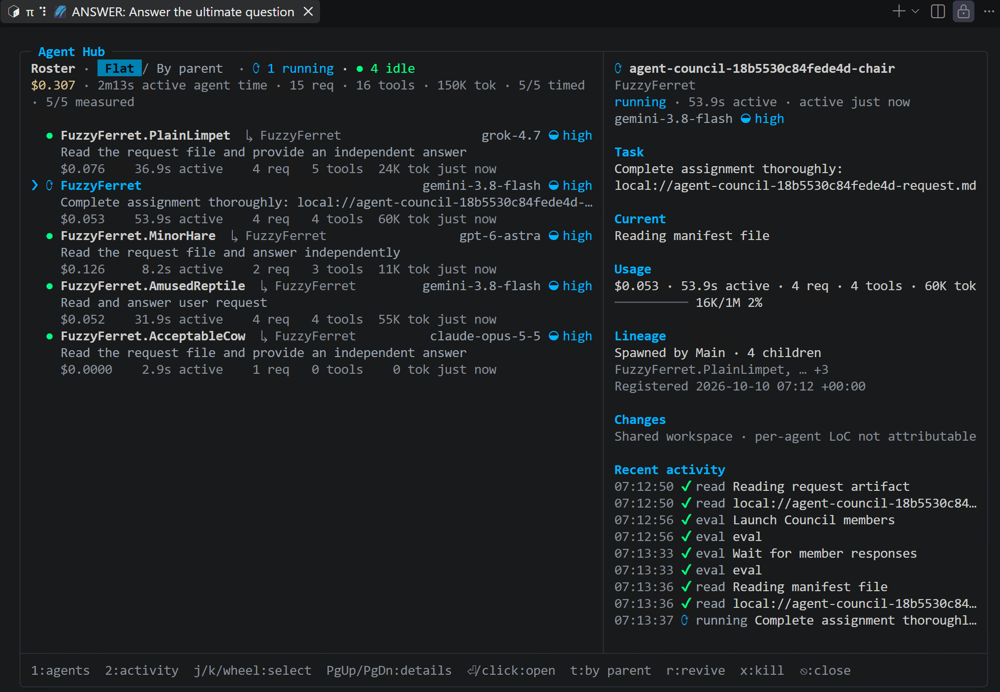
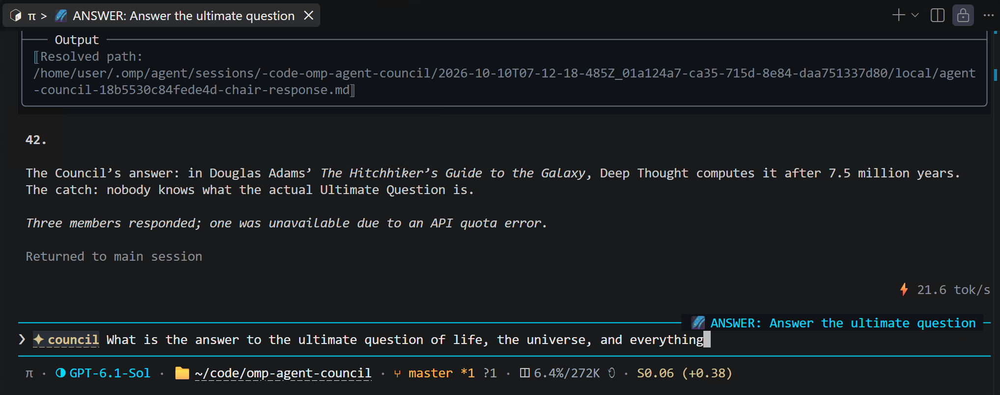

# omp-agent-council

Independent reviews and one combined answer for [OMP (Oh My Pi)](https://github.com/can1357/oh-my-pi). Choose 2–8 reviewers, their models, and thinking levels; get recommendations with agreements, disagreements, and risks.

## In action

A Council answering “What is the answer to the ultimate question of life, the universe, and everything?”

Follow reviewer progress and model usage in OMP's Agent Hub:



The combined answer returns to your conversation, noting any unavailable reviewers:



## Install

Requires **OMP 18.6.1 or newer** and access to the models you want to use. Tested with OMP 18.8.4.

```sh
omp plugin install github:piyop1y0/omp-agent-council
omp plugin doctor
```

Restart OMP after installation. The package is not published to npm.

## Use

Ask for a Council in your OMP session:

```text
Use a Council to review this design and recommend an approach.
Highlight disagreements and material risks.
```

Without configuration, you get three `@slow` reviewers, with your current model combining their answers. You can choose models and thinking levels in your request:

```text
Use a Council with @slow and openai-codex/gpt-6-astra:high
to compare these implementation approaches.
```

Use `provider/model:level` to choose a model and thinking level. A bare role such as `@slow` keeps its configured model and thinking level; adding a suffix overrides that level. `@default` uses your current session's model and thinking level. Supported levels depend on the model and provider.

A Council makes multiple model calls, so expect more usage than a single answer.

### Follow-ups

Continue in the same session:

```text
Ask the same Council to review this revised design.
```

The original reviewers reconsider the question and you get an updated combined answer.

## Configure defaults

Run `/council-config` to edit your user defaults, or `/council-config project` for the current project.

```json
{
  "member_models": ["@slow", "openai-codex/gpt-6-astra:high"],
  "chair_model": "@default",
  "tool_mode": "readonly"
}
```

- `member_models`: 2–8 reviewer model selectors. Default: three `@slow` reviewers.
- `chair_model`: the Chair that combines the reviews into the final answer. Default: `@default`.
- `tool_mode`: `readonly` for review work (default), or `full` when reviewers should make changes.
- `isolate_members`: use separate worktrees for reviewers (default: `false`). Isolated reviewers may be unavailable for follow-ups after their worktrees are removed.

Requests override project defaults, which override user defaults, then built-in defaults. Each setting falls back independently.

You can also save a complete configuration with `/council-config [user|project] {JSON}`. **This replaces that scope's entire configuration**, rather than merging individual keys.

Existing configurations: rename `judge_model` to `chair_model` and restart OMP after updating the plugin.

User configuration is normally `~/.omp/agent/agent-council.json`; `omp config path` shows the active user directory. Project configuration is `.omp/agent-council.json`.

Read-only mode is guidance, **not a security sandbox**.

### OMP settings

Set `task.maxRecursionDepth` to at least `2`, or a negative value for unlimited depth. To use `isolate_members`, also enable `task.isolation.enabled`.

## Develop locally

```sh
git clone https://github.com/piyop1y0/omp-agent-council.git
cd omp-agent-council
bun install
omp plugin link .
omp plugin doctor
```

Restart OMP after linking or updating the checkout.

```sh
bun test
bun run typecheck
```

## License

[MIT](LICENSE).
